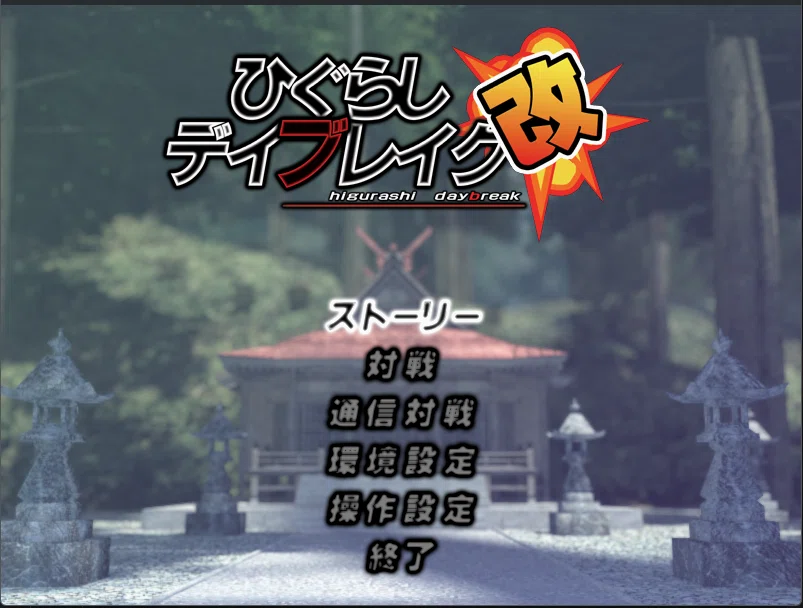
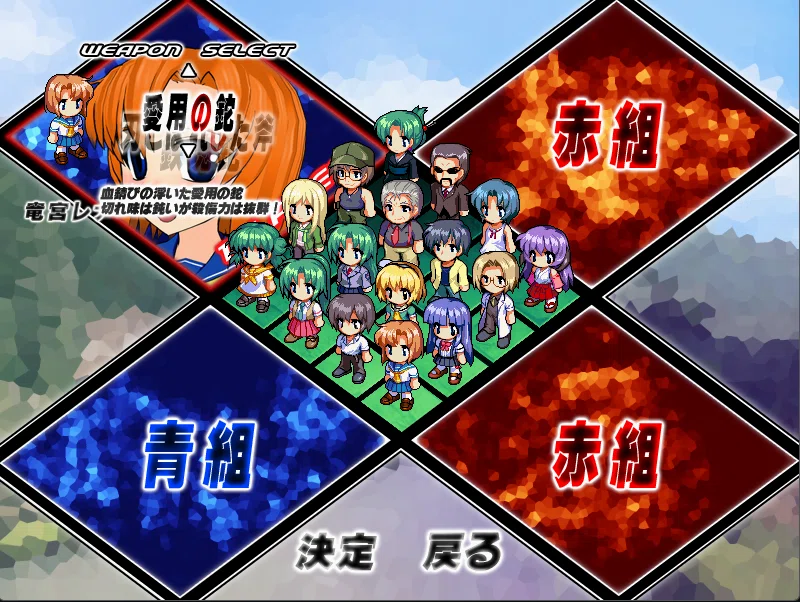
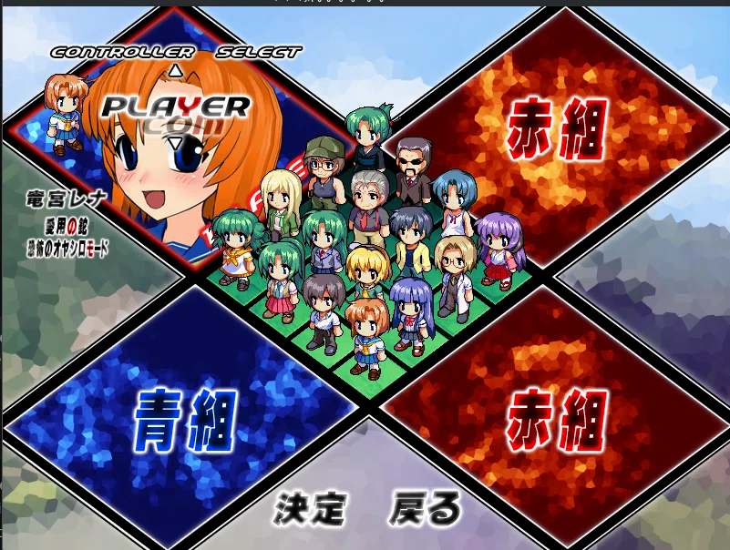
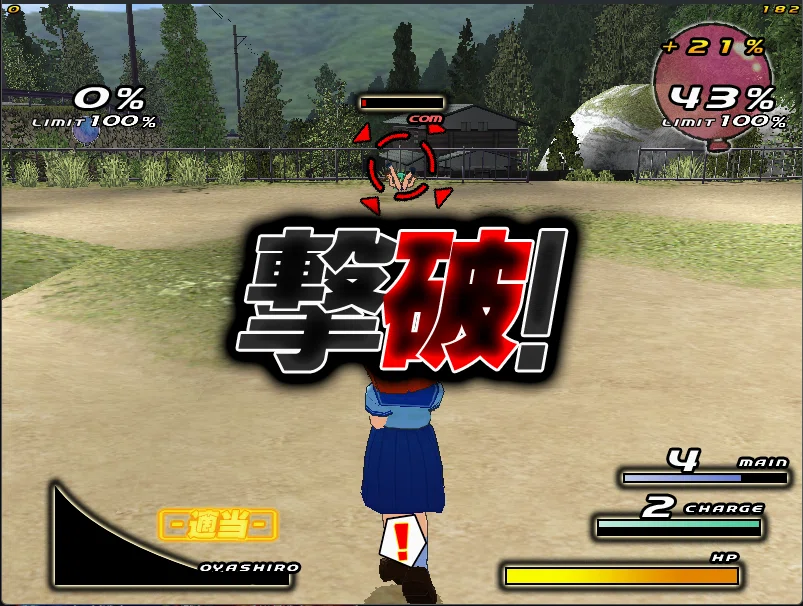
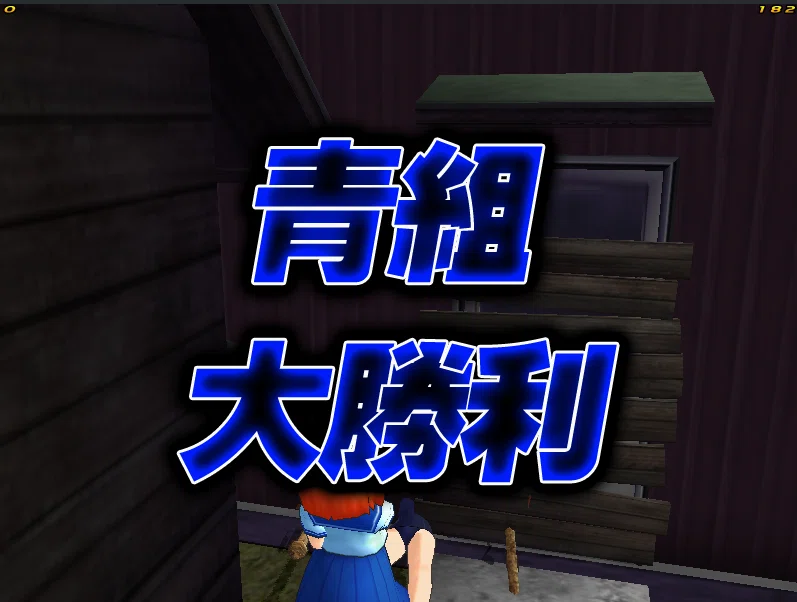
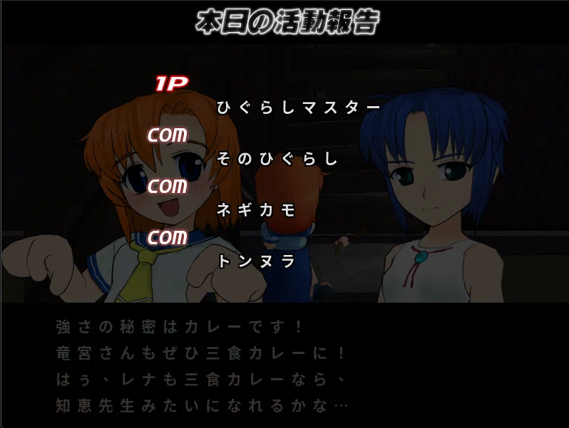
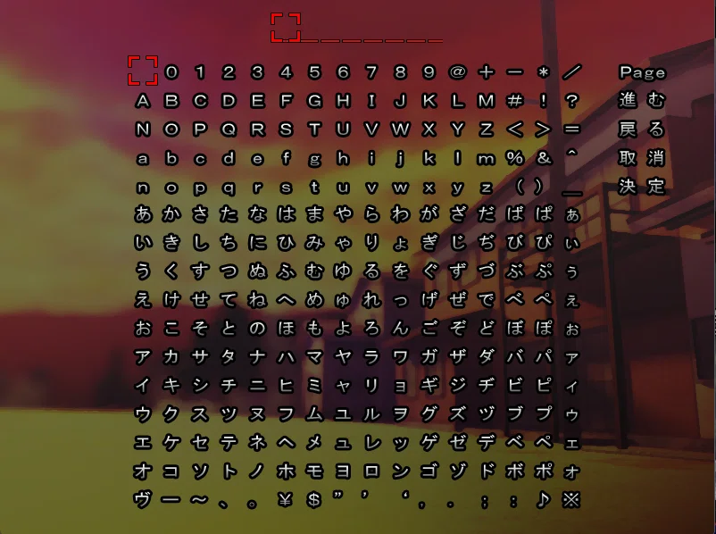
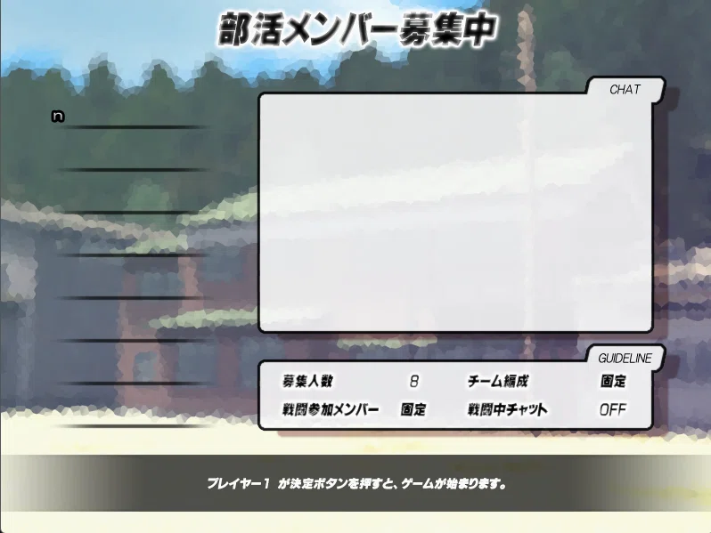
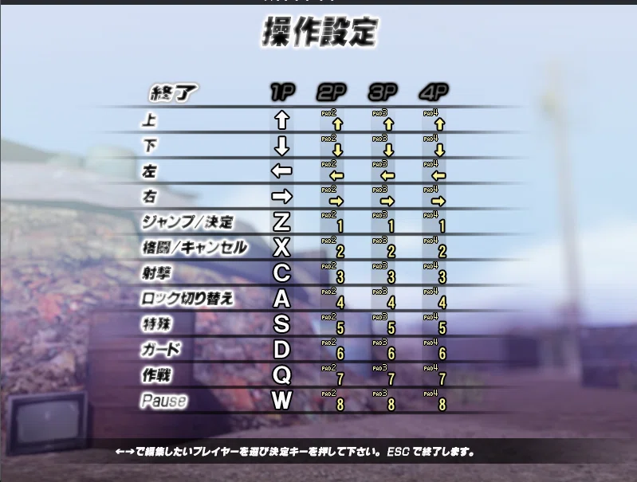

# Visual reference — original game captures

> Ground truth for the remake. Each image is a capture from the original
> `DaybreakDX.exe` (v1.11) with notes on what it pins down.
> Shots live next to this file; add rows as new captures arrive.

The table records original-game observations plus implementation status as of
2026-10-04, including DX9-era names. Those notes are historical, not a current
work list. Consult [`../../foundation/docs/ROADMAP-PENDING.md`](../../foundation/docs/ROADMAP-PENDING.md)
for implementation status and [`../decisions.md`](../decisions.md) for binding
choices, including the 4:3 menu canvas and automatic battle aspect (D8).

| Shot | Scene / moment | What it pins down |
|---|---|---|
|  | `movie/op.mpg`, early frame: shrine interior, purple curtain, lone fighter (blue hair, red footwear) facing the altar | OP movie look (letterboxed, purple grade); letterbox bars are in the video itself. The opening player is implemented; web movie playback remains open. |
|  | Title menu, Story highlighted: logo top-center, 6 JP items centered over shrine-approach background | Menu composition for `Scene_Title`: logo block ~(170–630, 60–210)/800×600, items start y≈280, ~45px stride; selected item white, rest dark with outline; background = `data/title/back00` (shrine approach, stone lanterns flanking; the scene loads
`data/title/{back00,logo,title}` per `FUN_00410d60.c:28-33`). Correction 2026-10-03: an earlier
revision of this table said `data/select/bg00`, which is wrong - that file decodes to the four
青組/赤組 diamond panels of the select screen |
|  | Team select (first stop after Versus): blue 青組 vs red 赤組 diamond panels, chibi roster grid center, 決定/戻る bottom | Versus flow order: **team first, then characters**; team cursor is an outline on the two diamond panels; character cursor is grid-snapping (mouse-like but cell-fixed). The team/character selection flow is implemented; exact original navigation parity remains open. |
|  | Character select after picking blue: panel becomes portrait + 竜宮レナ nameplate, "CHARACTER SELECT" header, small red cell cursor on chibi | Original behavior: P1 defaults to Rena; the picked team's panel swaps to portrait + name (`data/select/p%02d` + `w%02d`); the cursor shrinks to one chibi cell and the hovered chibi plays its walk animation. Selection is implemented; exact navigation/visual parity remains open. |
|  | Weapon/costume pick: "WEAPON SELECT" header, weapon name + ▲▼ arrows + flavor text over portrait, chibi costume updates live | Original navigation: **up/down = weapon, left/right = costume**; panel shows weapon name + description + affected chibi. Punishment clothes are a session-scoped unlock, not a persisted user setting. |
|  | Hypermode pick (after weapon): "HYPERMODE SELECT", mode name + description, e.g. 恐怖のオヤシロモード | 3 modes ([Friendship / Oyashiro / Kakera](https://higurashidaybreak.fandom.com/wiki/Hypermode), Kai adds Kakera): limit gauge fills on damage dealt+received; [Oyashiro](https://higurashidaybreak.fandom.com/wiki/Oyashiro-mode) fills by taking damage → +attack, +defense, stun immunity; [Kakera](https://higurashidaybreak.fandom.com/wiki/Kakera-mode) fills slower, triggers on death. Flow per slot: weapon → hypermode → player/CPU. Versus options include time limit, defense mod, gauge rate ([Menus](https://higurashidaybreak.fandom.com/wiki/Menus)) |
|  | Controller pick per slot: "CONTROLLER SELECT", PLAYER/COM toggle + ▲▼, summary lines (char/weapon/mode) | Slot flow confirmed: weapon → hypermode → **PLAYER-or-COM**; panel recaps the full build (竜宮レナ/愛用の鉈/オヤシロモード); up/down toggles human vs bot — this is where versus bots are assigned |
|  | Slot locked: 準備完了！ stamp + 1P tag over portrait, 決定 highlighted with red arrows | Lock-in visual: stamp + player tag; cursor roams freely but only 決定/戻る act. Cancel (X = melee/cancel) on a filled team slot **deselects back to character pick** — cancel is slot-contextual, not global back. |
|  /  | Stage + battle settings: "STAGE SELECT" (defaults ランダム, ? thumbnail) → e.g. 雛見沢分校 校庭 昼 with preview thumb; "BATTLE SETTING": 制限時間 ∞, 体力値 100%, ゲージ増加量 100%, 青/赤チーム風船サイズ 100%; 戦闘開始/戻る | One list, **left/right edits the focused row** (up/down moves focus); stage rows gain a variation sub-row (e.g. 昼); each stage shows a thumbnail. The **per-team balloon size %** is a handicap setting. Stage and battle settings are implemented and connected to `MatchConfig`; original value domains are documented in [`../../foundation/docs/FRONTEND-PLAN.md`](../../foundation/docs/FRONTEND-PLAN.md) §2.9. |
|  | VS intro sting (final frame): blue team top (portraits + nameplates 竜宮レナ/知恵留美子), red bottom (園崎詩音 ×2 — the twins), animated VS center | Portraits slide in from the sides and stop, VS animates center — the port implements this transition. Unfilled slots auto-fill with COM fighters under the port's seeded selection policy. |
|  | Live battle (schoolyard): Rena mid-frame with cleaver, enemy Mion top-center with lock reticule | **Original HUD evidence**: top corners show team balloon/LIMIT and player/FPS markers; target uses a reticle, COM tag and HP bar. Bottom-left has the hypermode gauge; bottom-right shows MAIN, CHARGE and HP. The port implements multi-view HUDs; consult [`../../foundation/docs/BATTLE-HUD-SPEC.md`](../../foundation/docs/BATTLE-HUD-SPEC.md) and the pending-work roadmap for detail. |
|  | Battle with ally in frame (white dress, green HP + `com` tag overhead); STAMINA bar center-bottom; Rena mid-dash arms-out | **Original behavior**: the stamina bar appears during dash/jump/block, drains while held and refills afterward; jumping also spends stamina. Allies use the same overhead HP/COM grammar without nameplates. |
|  | MAIN counter close-up: `3` with bar at half fill | **Ammo bars are proportional**: fill fraction = count/max (3/6 = half). The refill sweep **is the recharge timer readout** — no separate cooldown UI. The port draws a proportional fill (3/6 displays the full gradient within half the bar width). |
|  | KO frame: giant 撃破！ center, red balloon inflated (43%, `+21%` delta readout), enemy HP bar emptied under reticule | **Original KO evidence**: fullscreen kanji sting, balloon increase and floating `+N%` delta; this frame shows +21%. Overkill credits +1 per hit on a downed fighter. KO and respawn are implemented; the separate recovered respawn presentation window is not yet modeled. |
|  | Match end: 青組 大勝利 (blue team great victory) fullscreen over frozen arena | **Result sting is staged**: team name kanji appear first, then the victory phrase — two-beat text animation, skippable into rematch/title. Control audit: Z = jump/confirm, X = melee/cancel, C = shoot; the port's key bindings are configurable (D10). |
|  /  | Post-match: winner portraits + quote text box ("強さの秘密はカレーです！"…), then 本日の活動報告 ranking (1P/COM tags + earned titles like ひぐらしマスター); Z advances | Result is a **sequence**: sting → quote (per-character win line, Z to advance) → activity report (slot tags + titles). The result sequence and return to selection are implemented; exact title-chain conditions for unrecovered fields remain explicitly skipped and logged. |
|  | Netplay (通信対戦): host / connect-by-IP (`000.000.000.000`) / connect-from-list (`addresslist.txt`), name, ディレイ設定 3, port 37564, chat OFF, hint bar | **Original menu evidence**: default port **37564**, server list `addresslist.txt`, chat toggle, and delay setting 3. These fields inform a future LAN design; netplay is not implemented. Name/port/IP editing implies text entry (next row). |
|  | Software keyboard for name entry: ASCII + kana grids, red cell cursor, Page/進む/戻る/取消/決定 actions | Text entry is an in-game grid keyboard (no OS IME); the port has a reusable widget, while a netplay host remains outside current scope. |
|  | Online room (部活メンバー募集中): name list left, CHAT panel right, GUIDELINE box (募集人数 8, チーム編成 固定, 戦闘参加メンバー 固定, 戦闘中チャット OFF), hint bar (P1 confirm starts) | **Original lobby fields**: capacity 8, fixed teams and battle members, in-battle chat flag, and host-start. They are reference evidence for any future LAN design, not current product requirements. |
|  | Options (描面と音量の設定): toon rendering 有効/無効, shadows 有効/無効, texture res 普通/低, window/fullscreen, 4 volume sliders (master/music/voice/SFX), 終了, hint bar | The screenshot documents the original controls. The port exposes display/audio settings and live toon/shadow toggles; texture-resolution selection remains open (roadmap issue #21, row 2). |
|  | Controller setup (操作設定): 1P keyboard vs 2–4P pads, full binding table | **Original bindings**: Z jump/confirm, X melee/cancel (格闘!), C shoot, A lock-switch, S special, D guard, Q tactics (作戦), W pause; P2–4 use pads. The port models the recovered actions, including tactics and lock-switch, and supports per-player keyboard/gamepad rebinding; see the control mapping in `foundation/src/input/input_sdl3.h` and persistence policy in `foundation/docs/USER-SETTINGS.md`. |

## Notes

- `opening-frame-01`: black bars top/bottom are part of the `.mpg`
  (803×633 capture of an 800×600 window), not a viewport — don't
  reproduce in-engine.

## Battle settings — full option list (`stage-select-*.webp`)

One focus list: up/down moves focus, **left/right edits the focused
row**. Applies to versus matches; defaults are visible in these prints. The
original's ranges and steps were recovered in
[`../../foundation/docs/FRONTEND-PLAN.md`](../../foundation/docs/FRONTEND-PLAN.md) §2.9.

| Row (JP) | Meaning | Default (seen) | Values |
|---|---|---|---|
| STAGE SELECT: stage | Arena; starts at ランダム (`?` thumb) | ランダム | e.g. 雛見沢分校 校庭, each with a preview thumbnail |
| STAGE SELECT: variation | Sub-row under stage (appears after leaving random) | — | 昼 / 夕方 / 夜; stage 1 cycles by its available count, other stages have two variations |
| 制限時間 (time limit) | Match timer; expiry follows round rules | ∞ (no limit) | 0, 60, 120, 180, 240 seconds (`0 = ∞`) |
| 体力値 (HP value) | HP modifier for all fighters | 100% | 50–200%, 25% steps |
| ゲージ増加量 (gauge rate) | Limit-gauge charge rate (hypermode meters) | 100% | 50–200%, 25% steps |
| 青チーム風船サイズ (blue balloon size) | Handicap: blue team's balloon capacity | 100% | 40–200%, 20% steps |
| 赤チーム風船サイズ (red balloon size) | Handicap: red team's balloon capacity | 100% | 40–200%, 20% steps |
| 戦闘開始 / 戻る | Start match / back | — | Confirm/back, same 決定/戻る semantics as select screens |
