# Visual reference — original game captures

> Ground truth for the remake. Each image is a capture from the original
> `DaybreakDX.exe` (v1.11) with notes on what it pins down.
> Shots live next to this file; add rows as new captures arrive.

Implementation reminders in the table record the capture-time audit, including
DX9-era `Scene_*` names and then-missing features. They are not a current work
list. Consult [`../../foundation/docs/ROADMAP-PENDING.md`](../../foundation/docs/ROADMAP-PENDING.md)
for implementation status and [`../decisions.md`](../decisions.md) for binding
choices, including the 4:3 menu canvas and automatic battle aspect (D8).

| Shot | Scene / moment | What it pins down |
|---|---|---|
| 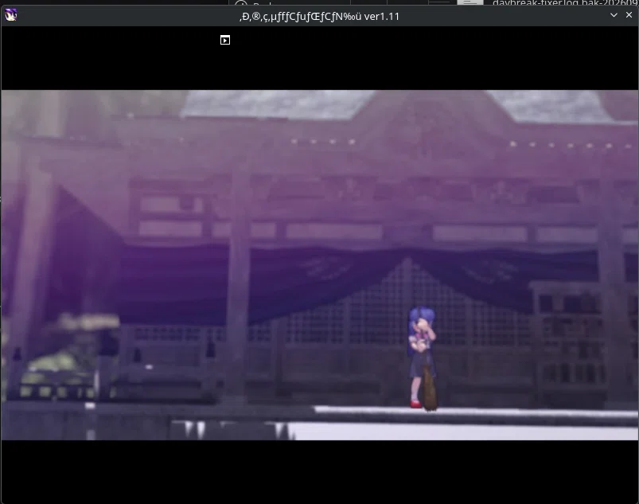 | `movie/op.mpg`, early frame: shrine interior, purple curtain, lone fighter (blue hair, red footwear) facing the altar | OP movie look (letterboxed, purple grade); our `VideoPlayer` must reproduce this framing — letterbox bars are in the video itself |
|  | Title menu, Story highlighted: logo top-center, 6 JP items centered over shrine-approach background | Menu composition for `Scene_Title`: logo block ~(170–630, 60–210)/800×600, items start y≈280, ~45px stride; selected item white, rest dark with outline; background = `data/title/back00` (shrine approach, stone lanterns flanking; the scene loads
`data/title/{back00,logo,title}` per `FUN_00410d60.c:28-33`). Correction 2026-10-03: an earlier
revision of this table said `data/select/bg00`, which is wrong - that file decodes to the four
青組/赤組 diamond panels of the select screen |
| 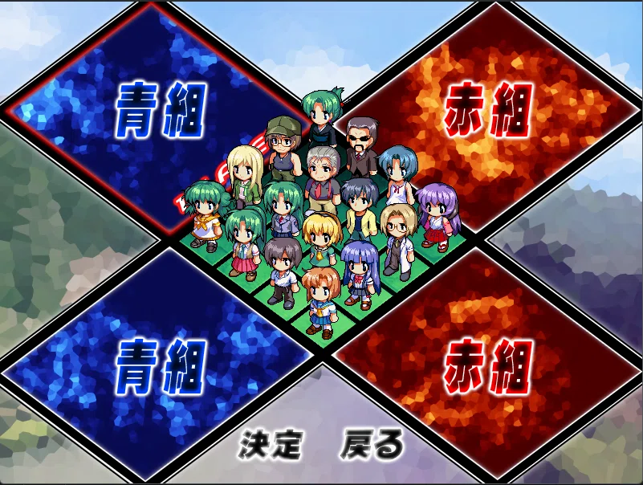 | Team select (first stop after Versus): blue 青組 vs red 赤組 diamond panels, chibi roster grid center, 決定/戻る bottom | Versus flow order: **team first, then characters**; team cursor is an outline on the two diamond panels; character cursor is grid-snapping (mouse-like but cell-fixed). New `Scene_TeamSelect` needed ahead of `Scene_CharacterSelect` |
| 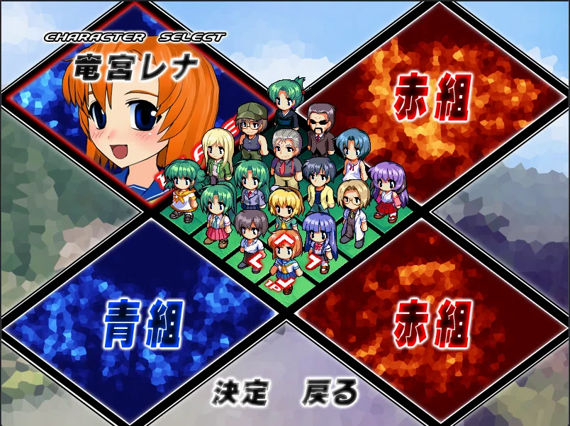 | Character select after picking blue: panel becomes portrait + 竜宮レナ nameplate, "CHARACTER SELECT" header, small red cell cursor on chibi | P1 default cursor = Rena; picked team's panel swaps to portrait+name (`data/select/p%02d` + `w%02d` winner-style art); cursor shrinks to one chibi cell; hovered chibi plays its walk animation (cursor = animation trigger, not just highlight) |
|  | Weapon/costume pick: "WEAPON SELECT" header, weapon name + ▲▼ arrows + flavor text over portrait, chibi costume updates live | Nav: **up/down = weapon (3 each), left/right = costume**; panel shows weapon name + description + affected chibi. "Punishment clothes": losing streaks/random unlock extra costumes **for the session only** (no persistence — session flag set, not a save) |
| 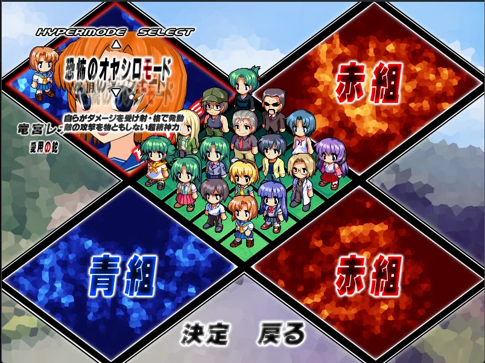 | Hypermode pick (after weapon): "HYPERMODE SELECT", mode name + description, e.g. 恐怖のオヤシロモード | 3 modes ([Friendship / Oyashiro / Kakera](https://higurashidaybreak.fandom.com/wiki/Hypermode), Kai adds Kakera): limit gauge fills on damage dealt+received; [Oyashiro](https://higurashidaybreak.fandom.com/wiki/Oyashiro-mode) fills by taking damage → +attack, +defense, stun immunity; [Kakera](https://higurashidaybreak.fandom.com/wiki/Kakera-mode) fills slower, triggers on death. Flow per slot: weapon → hypermode → player/CPU. Versus options include time limit, defense mod, gauge rate ([Menus](https://higurashidaybreak.fandom.com/wiki/Menus)) |
|  | Controller pick per slot: "CONTROLLER SELECT", PLAYER/COM toggle + ▲▼, summary lines (char/weapon/mode) | Slot flow confirmed: weapon → hypermode → **PLAYER-or-COM**; panel recaps the full build (竜宮レナ/愛用の鉈/オヤシロモード); up/down toggles human vs bot — this is where versus bots are assigned |
| 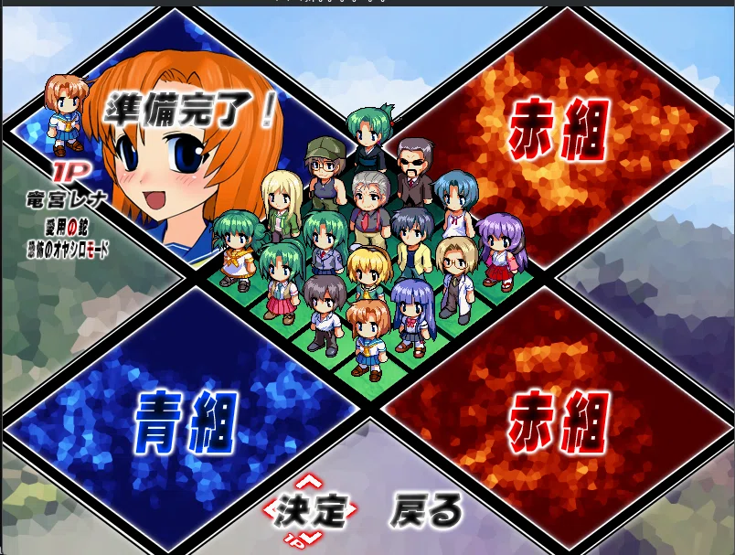 | Slot locked: 準備完了！ stamp + 1P tag over portrait, 決定 highlighted with red arrows | Lock-in visual: stamp + player tag; cursor roams freely but only 決定/戻る act. Cancel (X = shoot button) on a filled team slot **deselects back to character pick** — cancel is slot-contextual, not global back. Next: match settings |
| 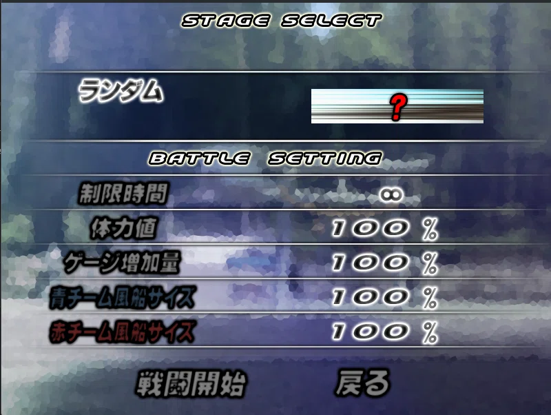 / 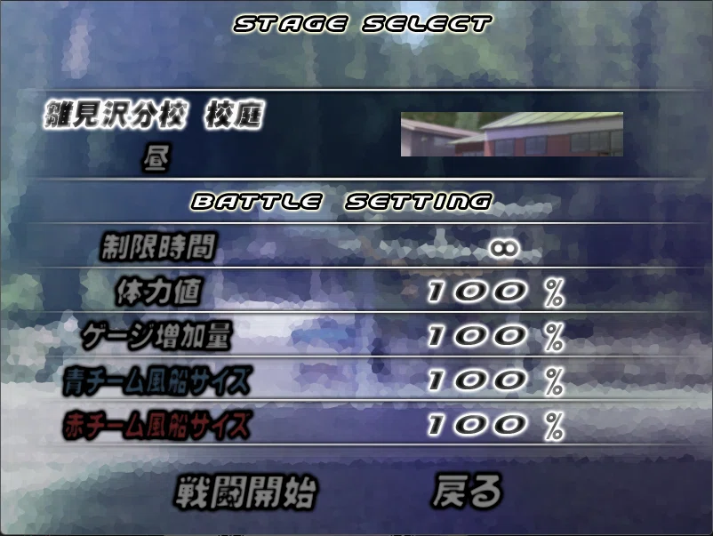 | Stage + battle settings: "STAGE SELECT" (defaults ランダム, ? thumbnail) → e.g. 雛見沢分校 校庭 昼 with preview thumb; "BATTLE SETTING": 制限時間 ∞, 体力値 100%, ゲージ増加量 100%, 青/赤チーム風船サイズ 100%; 戦闘開始/戻る | One list, **left/right edits the focused row** (up/down moves focus); stage rows gain a variation sub-row (e.g. 昼); each stage shows a thumbnail. New knob discovered: **per-team balloon size %** — handicap system; spec §3.5 needs a size multiplier. Settings map 1:1 to match config (time/HP/gauge/balloon-blue/balloon-red) |
| 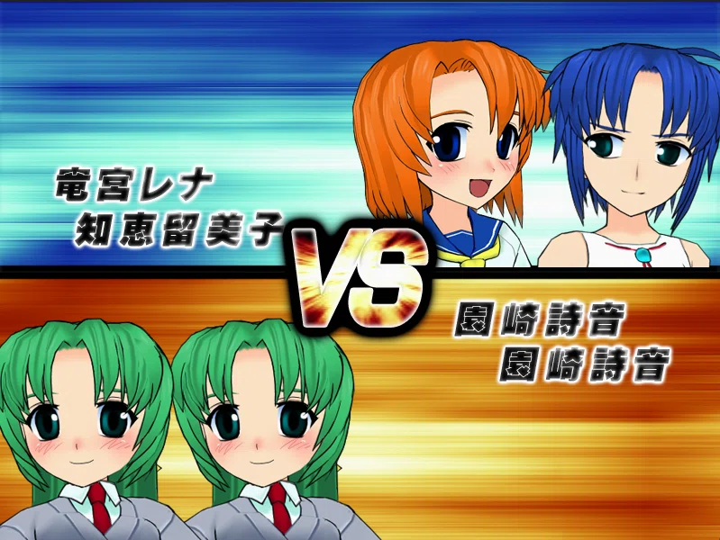 | VS intro sting (final frame): blue team top (portraits + nameplates 竜宮レナ/知恵留美子), red bottom (園崎詩音 ×2 — the twins), animated VS center | Portraits slide in from the sides and stop, VS animates center — a skippable intro scene (`Scene_VS` with entry tween, not a static image). Team slots left unset become **COM with random characters** (auto-fill rule, no empty slots ever) |
| 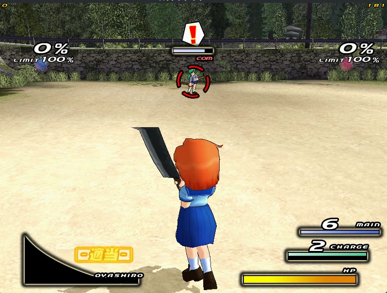 | Live battle (schoolyard): Rena mid-frame with cleaver, enemy Mion top-center with lock reticule | **HUD layout (all corners, compact)**: top-left/right = balloon % + `LIMIT 100%` per team (lose when balloon > limit — limit, not fixed 100%); tiny digit = player index (top-left), **FPS counter top-right (game shows its own fps!)**; target = red circular reticule + `com` tag + `!` when they target you + HP bar overhead. Bottom-left = super/limit gauge labeled with hypermode (`OYASHIRO`). Bottom-right = three counter bars: MAIN shots (6, blue), CHARGE stock (2, green), HP (yellow). Camera: behind-player, enemy framed top-center |
| 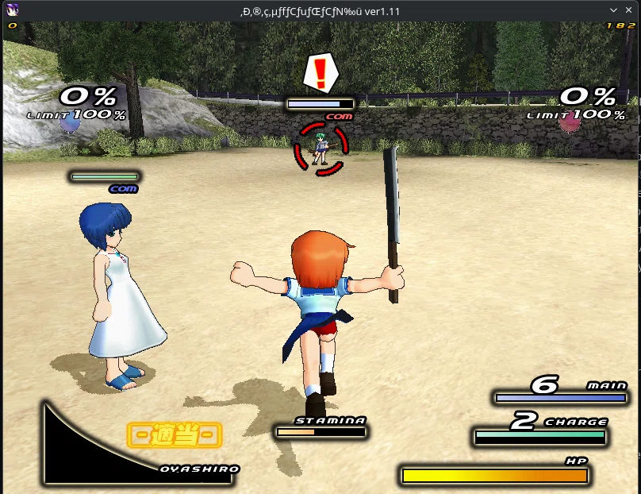 | Battle with ally in frame (white dress, green HP + `com` tag overhead); STAMINA bar center-bottom; Rena mid-dash arms-out | **Stamina is contextual**: bar appears only while dashing/jumping/blocking, drains on hold, refills fast after. Correction: **jump also spends stamina** (spec §3.4 said dash/block only). Allies render nameplate-free — green HP + `com` tag only, same overhead grammar as enemies |
| 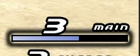 | MAIN counter close-up: `3` with bar at half fill | **Ammo bars are proportional**: fill fraction = count/max (3/6 = half). The refill sweep **is the recharge timer readout** — no separate cooldown UI; our HUD must animate fill, not just snap counts |
|  | KO frame: giant 撃破！ center, red balloon inflated (43%, `+21%` delta readout), enemy HP bar emptied under reticule | **KO presentation**: fullscreen kanji sting + balloon visibly inflates + floating `+N%` delta. Observed +21% (within wiki's 20–23% range). Overkill confirmed **+1/hit** on the downed fighter. KO flow = sting → inflate → delta readout → airborne respawn |
|  | Match end: 青組 大勝利 (blue team great victory) fullscreen over frozen arena | **Result sting is staged**: team name kanji appear first, then the victory phrase — two-beat text animation, skippable into rematch/title. **Control correction (owner)**: Z = jump, X = attack, C = shoot — audit `input_manager` bindings + spec control references against this; menu confirm keys need re-verification (Z confirmed in menus, so menus accept multiple buttons) |
| 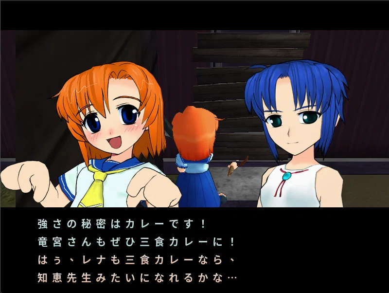 /  | Post-match: winner portraits + quote text box ("強さの秘密はカレーです！"…), then 本日の活動報告 ranking (1P/COM tags + earned titles like ひぐらしマスター); Z advances | Result is a **sequence**: sting → quote (per-character win line, Z to advance) → activity report (slot tags + titles, session-scoped like punishment clothes — no persistence). `Scene_Result` needs all three beats. **Loop closure**: Z on the report returns to **team select** — full versus loop is title → team → char → weapon → hypermode → controller → ready → stage → VS → battle → result → team |
| 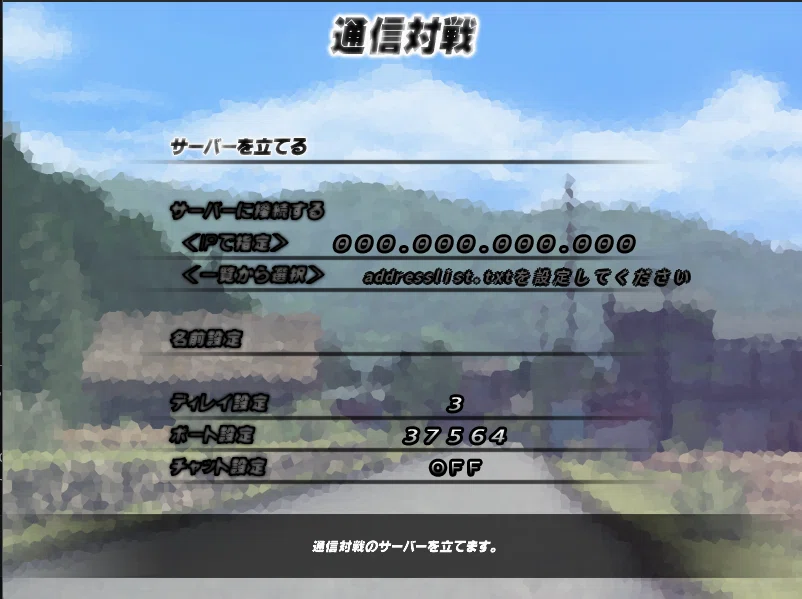 | Netplay (通信対戦): host / connect-by-IP (`000.000.000.000`) / connect-from-list (`addresslist.txt`), name, ディレイ設定 3, port 37564, chat OFF, hint bar | **Netplay spec captured**: default port **37564**, server list = `addresslist.txt` file, chat toggle, and a **delay setting (3)** — the original is delay-based netcode, which scopes our LAN replacement (input-delay + state sync, not rollback). Name/port/IP editing implies text entry (next row) |
|  | Software keyboard for name entry: ASCII + kana grids, red cell cursor, Page/進む/戻る/取消/決定 actions | Text entry is an in-game grid keyboard (no OS IME) — needed for name, IP, and list entries. Reusable widget: grid + snapping cursor + confirm/cancel, same input grammar as the char-select grid |
|  | Online room (部活メンバー募集中): name list left, CHAT panel right, GUIDELINE box (募集人数 8, チーム編成 固定, 戦闘参加メンバー 固定, 戦闘中チャット OFF), hint bar (P1 confirm starts) | **Lobby spec**: up to 8 players, fixed teams, fixed battle members, in-battle chat flag, host (P1) starts. Our LAN lobby needs exactly these fields: capacity, team lock, member lock, chat flag, host-start |
| 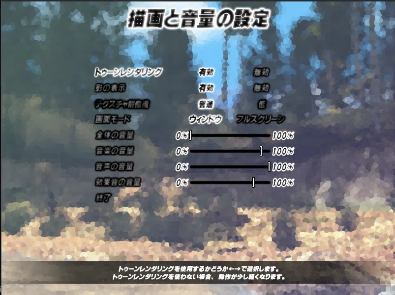 | Options (描面と音量の設定): toon rendering 有効/無効, shadows 有効/無効, texture res 普通/低, window/fullscreen, 4 volume sliders (master/music/voice/SFX), 終了, hint bar | **Option scope is tiny and closed**: 4 toggles + 4 sliders. Versus needs none of it except volumes — defer the rest; note toon rendering is itself an effect-system item |
|  | Controller setup (操作設定): 1P keyboard vs 2–4P pads, full binding table | **Authoritative bindings**: Z jump/confirm, X melee/cancel (格闘!), C shoot, A lock-switch, S special, D guard, **Q tactics (作戦 — new input, team orders?)**, W pause. 1P = keyboard arrows + keys; P2–4 = pad buttons 1–8. **Audit `input_manager` now**: our AttackA/B/Guard mapping must be re-derived from this table; tactics button is unmodeled anywhere |

## Notes

- `opening-frame-01`: black bars top/bottom are part of the `.mpg`
  (803×633 capture of an 800×600 window), not a viewport — don't
  reproduce in-engine.

## Battle settings — full option list (`stage-select-*.webp`)

One focus list: up/down moves focus, **left/right edits the focused
row**. Applies to versus matches; all values below confirmed on-screen
unless marked TODO (needs a value-cycling capture).

| Row (JP) | Meaning | Default (seen) | Values |
|---|---|---|---|
| STAGE SELECT: stage | Arena; starts at ランダム (`?` thumb) | ランダム | e.g. 雛見沢分校 校庭, each with a preview thumbnail |
| STAGE SELECT: variation | Sub-row under stage (appears after leaving random) | — | 昼 (day) seen; other times of day expected — TODO |
| 制限時間 (time limit) | Match timer; expiry presumably decides by balloon/HP | ∞ (no limit) | ∞ + timed values per [Menus](https://higurashidaybreak.fandom.com/wiki/Menus) (60/120/180/240s) — TODO confirm on-screen |
| 体力値 (HP value) | HP modifier for all fighters | 100% | Range/step TODO (capture cycling) |
| ゲージ増加量 (gauge rate) | Limit-gauge charge rate (hypermode meters) | 100% | Range/step TODO (capture cycling) |
| 青チーム風船サイズ (blue balloon size) | Handicap: blue team's balloon capacity | 100% | Range/step TODO (capture cycling) |
| 赤チーム風船サイズ (red balloon size) | Handicap: red team's balloon capacity | 100% | Range/step TODO (capture cycling) |
| 戦闘開始 / 戻る | Start match / back | — | Confirm/back, same 決定/戻る semantics as select screens |
