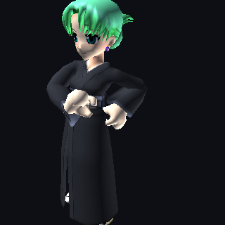
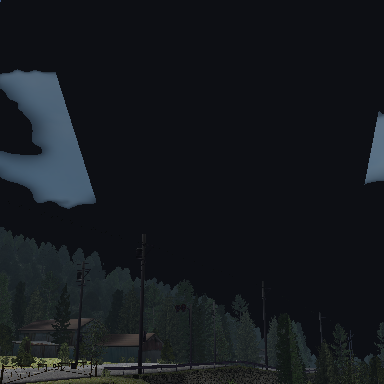
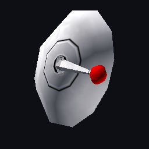
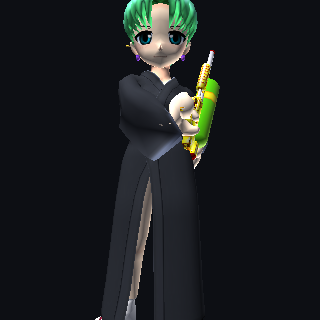
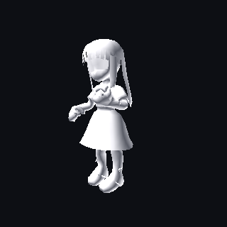
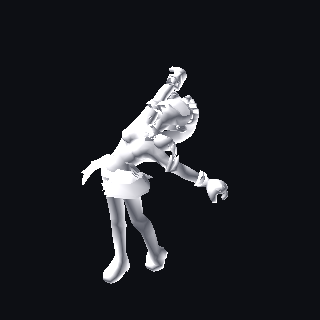

# webgpu-mvp — DirectX 9 `.x` assets on WebGPU

An MVP for taking this project's original `.X` assets off Direct3D 9 and onto
WebGPU (wgpu-native), without a conversion pipeline: the game's own files are read
directly, exactly as they ship.

```
xmodel.h       loader + skeletal animation + WebGPU layout helpers (GLM only)
cnv.h          .cnv texture decode + Shift-JIS name resolution + texture cache
sjis_table.h   CP932 -> UTF-8 table, GENERATED by tools/gen_sjis_table.py
scene.h        assembles stages / characters+costumes / weapons into one drawable scene
model.wgsl     skinning + texturing + fog shader (matches xmodel.h's bind groups)
build.sh       build the tools (host and MinGW cross)
tools/         fetch_deps.sh, gen_sjis_table.py, x2txt.py, xmodel_tool.cpp,
               verify_textures.cpp, wgpu_smoke.cpp
```

Nothing outside this folder is touched, and nothing here is wired into `remake/`.
D2 was **reversed on 2026-10-01**: the renderer now migrates to WebGPU, and this
folder is the evidence that decided it. D3 ("original `.X` files, no conversion
pipeline") is unchanged and still governs the asset path — this loader decodes all
728 shipped `.X` files, all 5051 `.cnv` images and the Shift-JIS references with no
conversion step, which is how it satisfies D3 on a different backend.

Every image below is real output from `wgpu_smoke` rendering the shipped assets with no
conversion step, textures and all — one per model category, plus the two earlier
untextured ones:








## Status — what is actually verified

| Claim | Evidence |
|---|---|
| All three shipped `.x` encodings parse | **728/728 assets load, 0 failures** (491 binary, 223 MSZIP, 14 text) |
| Skinning is correct | Bind-pose palette reproduces upright, correctly-sized geometry; animated frames render |
| Shader + vertex layout + bind groups work | `wgpu_smoke` renders real assets offscreen and reads the pixels back |
| Front faces are clockwise, projection needs **no** Y flip | Terrain (normals up) and a skinned character both draw correctly; see Conventions |
| Windows/MinGW target works | `wgpu_smoke.exe` under Wine renders the same frame **byte-for-byte** as the native Linux build |
| Ticks per second is 4800 | Every key time in every shipped animation set is a multiple of 80 ticks = exactly 1/60 s |
| 4 bone influences per vertex is enough | Max influences seen across the corpus is 4 (`XSkinMeshHeader` is captured for assertions) |
| Quaternion keys are a non-issue here | 727/728 files use **only** matrix keys (keyType 3/4) |
| Every shipped texture decodes | **5051/5051** `.cnv` images decode; the 3958 audio `.cnv` that share the extension are rejected structurally, not by luck |
| Texture references resolve | **4451/4493** material references (99.07%) resolve to a decoded image; the 42 misses are textures genuinely absent from those model directories |
| All three model categories render | 13 stages, 69 character/costumes, 46 weapons assemble and draw — **0 failures** |
| Frame rate is variable | Pose after 1 s is identical whether stepped once or at 30/60/120/144 Hz (max delta 3.8e-05, float accumulation only); repeats are bit-identical |

Not verified: production frame rates, texture loading (the game's textures are `.cnv`,
a separate problem), multi-track gameplay-driven blending, and the original game's
own render states. `wgpu_smoke` draws untextured lit geometry only.

### How those claims were checked

| Harness | What it catches |
|---|---|
| `xmodel_tool corpus <list>` over all 728 assets | parse failures, out-of-range indices, unresolved bones, palette size mismatches |
| `xmodel_tool winding` over the corpus | front-face convention, tested against the artists' own stored normals |
| `xmodel_tool skin` | palette errors: a wrong frame hierarchy shows up as a character that is not upright, or not the size of its bind pose |
| `x2txt.py` vs `xmodel_tool dump-text` | two independent implementations of the binary→text step must agree byte for byte |
| `wgpu_smoke` render + pixel readback | shader compilation, vertex layout, bind groups, palette indexing, projection, winding |
| ASan + UBSan build, plus truncation and byte-corruption fuzzing | memory-safety bugs on malformed input |
| `wgpu_smoke.exe` under Wine vs native | that the Windows/MinGW target behaves identically, including texture resolution |

Two bugs were found by that process, and both are worth knowing about because they
failed *quietly* rather than loudly:

- The text path used to start its lexer at offset 0 instead of past the 16-byte `xof`
  header. The lexer then read the magic line as the name of an unknown object and
  swallowed the next object with it, silently dropping geometry from any text asset
  whose first entry is a `Frame` or `Mesh` rather than a `template`. The shipped text
  assets happen to start with templates, so the corpus never noticed.
- `wgpu_smoke` used a tightly packed row pitch when copying the render target back to
  a buffer. That is only legal for widths that are multiples of 64; other sizes make
  wgpu abort the process.

## Quick start

```bash
./tools/fetch_deps.sh          # wgpu-native + glm into third_party/ (gitignored)
./build.sh both                # host tools + MinGW cross build
./build/xmodel_tool stats  <model.x>          # load one asset, print statistics
./build/xmodel_tool anims  <model.x>          # every animation set with its duration
./build/xmodel_tool skin   <model.x> [anim]   # bind/animated skinned bounds (CPU side)
./build/xmodel_tool corpus <path-list>        # load a list of files, report failures
./build/xmodel_tool sceneall <assetRoot>      # assemble every stage/character/weapon
./build/xmodel_tool dtcheck <model.x> [anim]  # frame-rate independence
./build/verify_textures <assetRoot>           # every .cnv decodes; every ref resolves

# render (needs model.wgsl in the working directory)
./build/wgpu_smoke --character=<base>/<name>:<costume> --out=frame.ppm
./build/wgpu_smoke --stage=<stageDir> --camera=player --out=frame.ppm
./build/wgpu_smoke --weapon=<bulletDir>:<slot> --out=frame.ppm
./build/wgpu_smoke <model.x> --no-textures --out=frame.ppm   # A/B against textured
```

`wgpu_smoke` writes a PPM; any image tool converts it for viewing.

Extracting assets from the game's `.dat` bundles is a separate, pre-existing step —
see the asset tools under `remake/tools/asset-tools/`.

## Using the loader

```cpp
#define XMODEL_IMPLEMENTATION
#include "xmodel.h"

xm::Model model = xm::loadFile("data/rika/01.X");     // text, binary or MSZIP
std::printf("%s\n", model.stats.toString().c_str());

// --- upload once -------------------------------------------------------------
for (xm::Mesh& mesh : model.meshes) {
    // vertex buffer  : mesh.vertices, sizeof(xm::Vertex) each
    // index buffer   : mesh.indices,  uint32
    // materials      : mesh.materials[i]; draw mesh.submeshes with DrawIndexed
}

// --- every frame -------------------------------------------------------------
xm::Controller ctl;
ctl.bind(&model);
ctl.setAnimation(model.findAnim("Anim-1"));      // or drive several tracks:
ctl.setTrackAnimationSet(1, overlayIndex);       //   track 0 = base body
ctl.setTrackWeight(1, 0.5f);                     //   track 1 = upper-body overlay
ctl.setTrackEnable(1, true);
ctl.advanceTime(dtSeconds);

std::vector<glm::mat4> world, palette;
ctl.evalWorld(world);

uint32_t offset = 0;                             // pack every mesh's palette back to back
for (xm::Mesh& mesh : model.meshes) {
    model.buildPalette(mesh, world, palette);    // skinned: one matrix per bone
    // memcpy `palette` into the palette storage buffer at matrix index `offset`
    for (xm::Submesh& sm : mesh.submeshes) {
        // draw with DrawUniform{ .paletteOffset = offset, ... }
    }
    offset += (uint32_t)palette.size();
}
```

`Controller` implements the part of `ID3DXAnimationController` the game drives: up to
8 tracks, each with its own animation set, weight, speed, position, enable flag and
loop flag. Tracks blend incrementally in track order, so a frame that only track 1
animates is unaffected by track 0 — the base/overlay split the original relies on.

## Textures

`.cnv` is the game's texture container and holds **both** images and PCM audio (3958 of
the 9009 shipped files are audio, in `data/se`, `data/voice`, `data/bgm`). The image
header is:

```
offset 0   u8   bits per pixel as declared by the writer
offset 1   u32  field1 — NOT reliably the width
offset 5   u32  height
offset 9   u32  width
offset 13  u32  compressed size (0 = stored)
offset 17  pixels, BGRA, rows top-down
```

Three things about it cost real time to establish, and two of them contradict the code
that shipped before:

- **The declared bpp lies.** 3468 of the 5051 images declare 24 while storing 4 bytes
  per pixel. The payload size is the truth, so `bytesPerPixel` is derived from it — the
  same workaround the DX9 fix uses.
- **`field1` is not the width.** `data/object/勝利バー.cnv` stores 257 there and 260 in
  the real width field, and the payload matches 260. The DX9 decoder requires the two to
  agree and therefore rejects that file; this one does not.
- **Names are Shift-JIS on one side and UTF-8 on the other.** A `.X` material writes
  `服.bmp` as raw CP932 while file and bundle names are UTF-8. That mismatch was the
  substance of the DX9 texture fix ("was miss-everything for non-ASCII names; 11/11
  fighter + all stage materials resolve"), and `TextureCache` reproduces it: try the
  UTF-8 name, then the stem with `.cnv`, then `.bmp`.

`sjis_table.h` is generated rather than hand-written, because the shipped assets use 315
distinct CP932 sequences and shipping all ~9800 mappings would be mostly dead weight.
`tools/gen_sjis_table.py --full` emits the complete table if that is ever needed.

There is a second, quieter half to the same problem: the resolved name is UTF-8, and on
Windows a narrow `fopen()` interprets that in the ANSI code page, so **every non-ASCII
texture misses silently** while ASCII ones still work. `cnv.h` opens through
`std::filesystem::u8path`, which is why the Windows build resolves all 13 of Akane's
textures and renders byte-identically to the Linux one. The DX9 remake never meets this
because it resolves names inside the `.dat` bundles in memory.

Row order is top-down (no flip), which is what the DX9 path does — it copies row *y* to
row *y* into the texture — and what the textured renders confirm.

## Scenes: the three model categories

`scene.h` encodes how the original assembles each category, read out of `DaybreakDX.exe`:

| Category | How it is put together |
|---|---|
| **Stage** | `FUN_004011f0` loads `data/stageNN/%02d.x` for i = 0..7 (or `%02db.x` when the config byte `stage+0x2c` is set): at most eight visible sub-models plus `collision.x` / `collision_camera.x` / `collision_tama.x`. **No transform or scale is ever applied** — the meshes are authored in world space, so they are drawn with an identity world matrix. `env.dat` supplies linear fog (start/end/colour) and the play area's spawn points; it moves nothing. |
| **Character** | `FUN_0064ab30` picks the directory from a costume index: 0..5 → `data/<char>/`, `_B`, `_C`, `_D`, `_E`, `_F`. The `.X` filename is *not* assumed — the unsuffixed `data/<char>/<id>.dat` starts with dword 4 followed by a 260-byte model name, and that name is loaded from the costume directory. Rigs and animation naming are uniform (Bip00/Bip01_*, 137 sets), so animation sets are portable across costumes and characters. |
| **Weapon** | A weapon rides `Bip01_Prop1` (or `Bip01_Prop2`), and its model name lives inside a `.dat`: `data/bullet/001/000.dat` names `"03.X"`, not `00.X`. `loadWeapon()` reads that name instead of guessing — `data/bullet/017` alone ships 22 `.X` files. Attachment is applied for real: the weapon is drawn with the owning character's prop-bone world matrix, which is checked numerically (it lands 14–23 units from the bone at hand height, ~50 units across, for a 153-unit character) and visually in the render above. |

Two consequences worth knowing:

- **Collision meshes are loaded but never drawn.** The original keeps them in their own
  slots and its render loop only walks the eight visible ones. They are useful here as
  the play area for framing (see below).
- **Framing a stage from its mesh bounds does not work.** The visible set includes an
  inverted sky dome tens of thousands of units across, centred on the arena, while
  `env.dat`'s fog ends at 10000 units — a bounds-fit camera sits outside the fog and
  renders a flat wall of fog colour. `--camera=player` puts the eye at a spawn point,
  which is what the game's own camera does. (`--camera=bounds` is still there, and shows
  the dome for what it is.)

## Frame rate

The original's cap is the monitor refresh rate, so animation is a function of elapsed
time and nothing else. Two things follow, and both are checked rather than asserted:

- `Controller::advanceTime(dt)` takes the real frame delta; there is no fixed timestep
  anywhere in the loader or the controller. `xmodel_tool dtcheck` advances 1 s as one
  step and as 30/60/120/144 steps and compares the resulting matrices: max delta 3.8e-05
  (float accumulation in the clock, not a logic difference), and repeating a schedule is
  bit-identical.
- Frame pacing belongs to the swapchain. `WGPUPresentMode_Fifo` — the only mode every
  adapter must support, and wgpu's default — is the vsync cap that matches the original's
  behaviour; nothing here hardcodes a rate. `--frames=N --dt=S` exercises the animation
  clock, and the tool states plainly that it does no GPU work per step.

## WebGPU integration

Vertex layout (80 bytes, `xm::Vertex`; `xm::wgpuVertexLayout()` fills this in):

| location | format | offset | contents |
|---|---|---|---|
| 0 | float32x3 | 0 | position |
| 1 | float32x3 | 12 | normal |
| 2 | float32x2 | 24 | uv |
| 3 | float32x4 | 32 | vertex colour (white when the file has none) |
| 4 | uint32x4  | 48 | bone indices |
| 5 | float32x4 | 64 | bone weights (sum to 1) |

Bind groups expected by `model.wgsl`:

```
group 0, binding 0   Camera uniform   xm::CameraUniform (112 bytes)
group 1, binding 0   Draw uniform     xm::DrawUniform (96 bytes), DYNAMIC OFFSET
group 1, binding 1   storage readonly array<mat4x4<f32>>  — all palettes, packed
group 2, binding 0   texture_2d<f32>  — bind a 1x1 white texture for untextured draws
group 2, binding 1   sampler
```

`xm::kDrawStride` is 256, the `minUniformBufferOffsetAlignment` every current adapter
guarantees; round up if `adapter.limits` reports a larger value. WebGPU has no push
constants, which is why the per-draw data travels in a dynamic-offset uniform.

### Conventions (the part that usually bites)

- **Do not negate `proj[1][1]`.** wgpu normalizes clip space to Y-up on every backend,
  so a left-handed projection is used *as-is*. The usual Vulkan-port step renders
  everything upside down here — `wgpu_smoke --flip-y=1` demonstrates exactly that.
- **`frontFace = "cw"`, `cullMode = "back"`.** Verified against the terrain: its
  normals point up, and only this combination draws the ground when viewed from above.
- **Index order is kept as authored**; the winding determination is about the assets'
  own convention, which the loader preserves.
- **No UV flip.** Both DX and WebGPU put the UV origin at the top-left.
- Matrices are transposed on load into GLM's column-vector form, so `v' = M * v` and
  `world = parent * local` throughout.

## Format notes (reverse-engineered here)

These came out of reading the shipped assets and are recorded because the public
documentation is either silent or wrong about them.

**Binary `.x`** (`xof 0303bin 0032`)
- Tokens are **16-bit**, not the 32-bit tokens the MSDN text implies.
- Files **omit the standard template definitions** (D3DX pre-registers them), so a
  reader that only trusts in-file templates cannot resolve `Frame` or `Mesh` at all.
  `xmodel.h` therefore carries a builtin table, overridden by in-file definitions.
- Declared template members are **flattened** into `INTEGER_LIST` / `REALNUM_LIST`
  runs; only undeclared children and `{ ref }` are real nested objects.
- Strings and names are **Shift-JIS**, and frame names can contain `{`, `}` and
  spaces (the shipped rigs have `_{_f_B` and `_X_J_[_g`), so the binary→text step
  quotes any name that is not a plain identifier.

**MSZIP `.x`** (`xof 0303bzip0032`)
- `u32` total uncompressed size (including the 16-byte header), then per block:
  `u16 blockOutSize`, `u16 blockCompSize`, `"CK"`, raw DEFLATE.
- **Blocks share a 32 KB LZ77 window**: each block's DEFLATE stream references the
  previous block's output, so blocks cannot be decoded in isolation ("invalid
  distance too far back"). Decoding every block into one continuous buffer makes the
  back-references resolve with no explicit dictionary handling.

**Animation data**
- Character files are overwhelmingly `keyType 4` (matrix keys); `xmodel.h` decomposes
  them into position/rotation/scale at load so every track blends in the same space,
  which is also what `ID3DXAnimationSet::GetSRT` hands back.
- `AnimTicksPerSecond` is absent from these files; 4800 (the D3DX default) is
  confirmed by every key time being a multiple of 80 ticks = one 60 Hz game frame.
- The binding decisions' note that mesh flags `0x220` means `32BIT | NPATCHES` is
  worth re-checking: in `d3dx9mesh.h`, `0x220` is
  `D3DXMESH_VB_MANAGED | D3DXMESH_IB_MANAGED`, i.e. D3DX memory-pool hints, not
  N-patches. No N-patch templates appear in the assets.

**Units** are centimetres: a character is ~153 units tall, a school stage ~40 000
units across.

## Tools

- `tools/x2txt.py` — Python reference implementation of the binary→text conversion.
  Same algorithm as the C++, useful for inspecting assets without building anything
  (`--stats`, `--dump-templates`, and plain conversion). Kept deliberately as the
  independent implementation the C++ was ported from and checked against.
- `tools/xmodel_tool.cpp` — `stats`, `anims`, `skin`, `palette`, `pose`, `winding`,
  `dump-text`, `corpus`, `scene`, `sceneall`, `dtcheck`.
- `tools/verify_textures.cpp` — every `.cnv` in a tree decoded and classified, then every
  model loaded and every material reference resolved.
- `tools/gen_sjis_table.py` — regenerates `sjis_table.h` from an asset tree (or `--full`).
- `tools/wgpu_smoke.cpp` — the renderer: single model, `--stage=`, `--character=`,
  `--weapon=`, with textures, fog, depth, and the winding/flip demonstrations.
- `tools/fetch_deps.sh`, `build.sh` — dependency fetch and builds.

## Known limits / next steps

- **Load cost.** Binary input is converted to text and parsed once, which keeps a
  single build path (and a dumpable artefact) at the cost of an intermediate string.
  A 10 MB character model is ~0.5 s end to end; the whole corpus (~1.4 GB of text)
  takes ~30 s. A direct binary builder is the obvious optimisation if load time
  matters.
- **Textures load, but materials are flat.** Diffuse/texture are used; the specular and
  emissive terms and the material `power` are parsed but not shaded, and there are no
  mipmaps (the original generates them, this path samples level 0). The baked-shadow
  decal treatment (`keyOutWhite`, multiply) exists in `cnv.h` but is not wired into the
  draw path, so shadow cards render as white plates under the normal blend.
- **No depth-tested draw sorting.** One pipeline, cull back, alpha test at the original's
  ref 0x08. Effect passes in the original disable culling and use additive blending
  (`FUN_004303b0`); those are not modelled yet, so trails/auras would draw wrong.
- **Effect/technique binding is not implemented.** `DeclData` and `EffectInstance`
  are detected and counted (`stats.hadDeclData`, `stats.hadEffectInstance`) but not
  applied. The baked-shadow decals the remake handles with a stencil trick have no
  equivalent here yet.
- **No N-patches, no multi-UV sets, no >4 influences** (extras are dropped, the
  remainder renormalised, the count kept in `Mesh::droppedInfluences`).
- **Weapon *selection* is not implemented.** Attachment to `Bip01_Prop1`/`Prop2` works,
  but *which* item a character carries comes from `data/item/<id>.dat`, and that table's
  layout did not match the structure the RE pass described (a 574-byte file, not
  0x970-stride entries), so it is deliberately left unparsed rather than guessed at. Pass
  the model explicitly (`--weapon=<path to a .X or a bullet dir>`) as the render above
  does. The table's per-entry local offset (position + two rotations, `FUN_00433eb0`) is
  likewise not applied, so a weapon sits at the bone itself.
- **`conjugateQuats` is untested against real quaternion keys** because no shipped
  asset has any. Leave it false unless an A/B test on a foreign `.x` says otherwise.
- **The Controller blends in SRT space.** Matrix keys are decomposed, so a channel
  with shear or non-uniform scale loses it. D3DX's own animation sets do the same.
